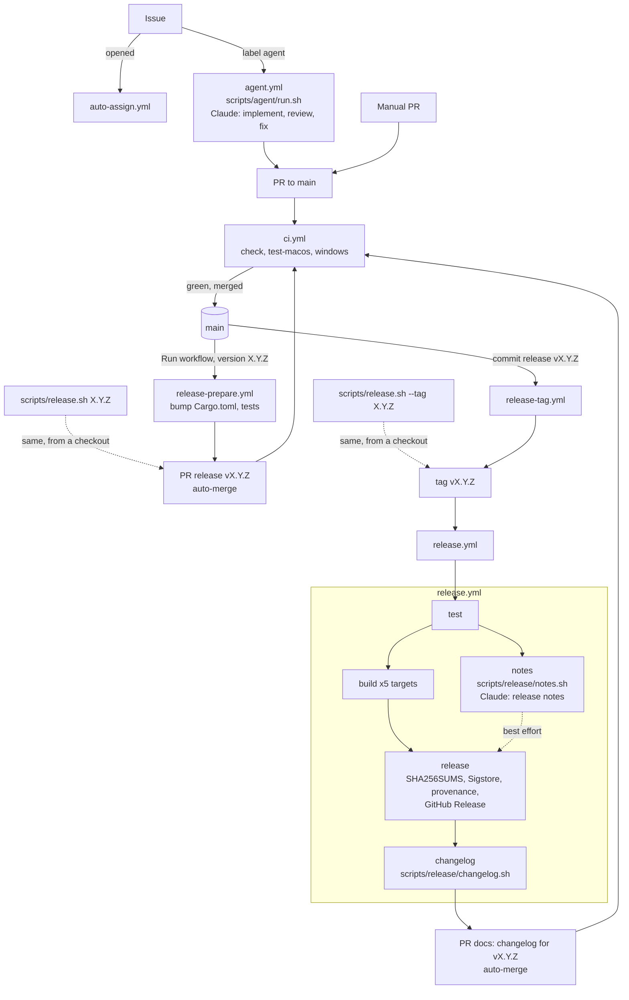

# Pipeline: from issue to release

How a change reaches a published twig release: the GitHub workflows, their jobs, the scripts they
run, where Claude runs as an agent, and which token each step uses. The step-by-step commands are in
[RELEASING.md](RELEASING.md) and the issue agent's setup is in [AGENT.md](AGENT.md).

## Overview

1. **Work** reaches `main` only through PRs, written by hand or by the issue agent, and merged once
   `ci.yml` is green.
2. **Release step 1** bumps the version on `release/vX.Y.Z` and opens the PR `release vX.Y.Z`
   (`release-prepare.yml` from Actions, or `scripts/release.sh X.Y.Z` locally).
3. **Release step 2**: when that PR merges, `release-tag.yml` pushes the annotated tag `vX.Y.Z`
   (or `scripts/release.sh --tag X.Y.Z` locally).
4. **Publish**: the tag starts `release.yml`, which tests, builds, writes the notes with Claude,
   signs and publishes the GitHub Release, then opens the PR that adds the notes to `CHANGELOG.md`.

## Workflows

| Workflow | Trigger | Runner | Token | What it does |
|---|---|---|---|---|
| [`ci.yml`](../.github/workflows/ci.yml) | PR to `main`, push to `main` | GitHub-hosted (Ubuntu, macOS, Windows) | `github.token` (read) | the required checks `check`, `test-macos`, `windows` |
| [`auto-assign.yml`](../.github/workflows/auto-assign.yml) | issue opened | Ubuntu | `github.token` | assigns the issue to the maintainer when it has no assignee |
| [`agent.yml`](../.github/workflows/agent.yml) | `agent` label added by the maintainer | self-hosted `twig-agent` | `AGENT_PAT` | issue → PR with Claude ([AGENT.md](AGENT.md)) |
| [`release-prepare.yml`](../.github/workflows/release-prepare.yml) | manual (`workflow_dispatch`), maintainer, from `main` | Ubuntu | `AGENT_PAT` | bumps the version, runs the tests, opens `release vX.Y.Z` with auto-merge |
| [`release-tag.yml`](../.github/workflows/release-tag.yml) | push to `main` with a `release vX.Y.Z` commit | Ubuntu | `AGENT_PAT` | checks `Cargo.toml`, pushes the tag `vX.Y.Z` |
| [`release.yml`](../.github/workflows/release.yml) | push of a `v*` tag | see jobs below | see jobs below | builds, signs, publishes, updates the changelog |

`release-prepare` and `release-tag` share the `release` concurrency group, so two releases never run
at the same time.

## Jobs of `release.yml`

| Job | Needs | Runner | Permissions | What it does | If it fails |
|---|---|---|---|---|---|
| `test` | — | Ubuntu | read | the tag matches `Cargo.toml`, `cargo test --locked` | no release |
| `build` | `test` | one per target: Linux musl x86_64 / ARM64, macOS Intel / Apple Silicon, Windows | read | builds and packages the binary with the skill and the herdr plugin | no release |
| `notes` | `test` | self-hosted `twig-agent` | read-only (contents, PRs, issues) | Claude writes the release notes | the release goes out with GitHub's generated notes |
| `release` | `build`, `notes` | Ubuntu | `contents`, `id-token`, `attestations` write | `SHA256SUMS`, Sigstore signature, build provenance, GitHub Release | no release |
| `changelog` | `release` | Ubuntu | `AGENT_PAT` | adds the notes to `CHANGELOG.md` through an auto-merged PR | the release is out; add the entry by hand |

`release` runs even when `notes` failed (`!cancelled()` and `build` succeeded), and `changelog` has
`continue-on-error`, so neither best-effort job can block or fail a published release.

## Scripts

| Script | Run by | What it does |
|---|---|---|
| [`scripts/release.sh`](../scripts/release.sh) | you, locally | the two release steps (`X.Y.Z`, then `--tag X.Y.Z`) without Actions |
| [`scripts/release/notes.sh`](../scripts/release/notes.sh) | `release.yml` → `notes` | collects the PRs merged and issues closed since the previous tag and sends them to `claude -p` with [`notes-prompt.md`](../scripts/release/notes-prompt.md); `NOTES_DRY=1` only prints what it would send |
| [`scripts/release/changelog.sh`](../scripts/release/changelog.sh) | `release.yml` → `changelog` | turns the release description into the `## [X.Y.Z] - date` entry and the compare link of `CHANGELOG.md`; skips a version already there |
| [`scripts/agent/run.sh`](../scripts/agent/run.sh) | `agent.yml` | the issue → PR loop, with the prompts in [`scripts/agent/prompts/`](../scripts/agent/prompts) |

## Agents

Claude Code runs in two places, both on the self-hosted `twig-agent` runner with the maintainer's
Claude subscription login (`ANTHROPIC_API_KEY` is unset, so nothing is billed per token).

| Agent | Where | Input | Tools | Output |
|---|---|---|---|---|
| Implementer | `agent.yml` → `run.sh`, prompt `implement.md` | the issue and the maintainer's comments | edits files and runs commands in the worktree, without `GH_TOKEN` | commits on `agent/issue-N` |
| Reviewer | `agent.yml` → `run.sh`, prompt `review.md` | the PR diff, fresh session | read-only | findings for the fixer |
| Fixer | `agent.yml` → `run.sh`, prompt `fix.md` | review findings, failing CI logs | like the implementer | fix commits (up to 3 review and 3 CI rounds) |
| Release notes writer | `release.yml` → `notes` → `notes.sh` | PR and issue text since the previous tag | none (`--tools ""`) | the markdown of the release description |

The script, not Claude, pushes, opens the PR and sets labels. PR and issue text is treated as
untrusted data in every prompt.

## Tokens and secrets

| Token | Used by | Why |
|---|---|---|
| `github.token` | `ci.yml`, `auto-assign.yml`, `release.yml` (`test`, `build`, `notes`, `release`) | scoped to the run; enough when nothing else has to be triggered |
| `AGENT_PAT` | `agent.yml`, `release-prepare.yml`, `release-tag.yml`, `release.yml` → `changelog` | pushes, PRs and tags made with `github.token` don't start other workflows; with the PAT the PRs run `ci.yml` and the tag runs `release.yml` |
| Sigstore OIDC | `release.yml` → `release` | keyless signature of `SHA256SUMS`, verified by `install.sh` / `install.ps1` |
| `CLAUDE_CODE_OAUTH_TOKEN` | the `twig-agent` runner's `.env` | the Claude subscription login of the agents |

## Guard rails

- `main` only accepts PRs with `check`, `test-macos` and `windows` green; nothing pushes to it
  directly, including the release and changelog bumps.
- Only `RafaelKC` can start the issue agent, run `release-prepare` (and only from `main`), or have a
  `release vX.Y.Z` commit tagged.
- `release-tag.yml` only reacts to `release vX.Y.Z` commits, so the `docs: changelog for vX.Y.Z` PR
  never starts another release.
- Published `v*` tags can't be moved or deleted (branch rules in [RELEASING.md](RELEASING.md)).
